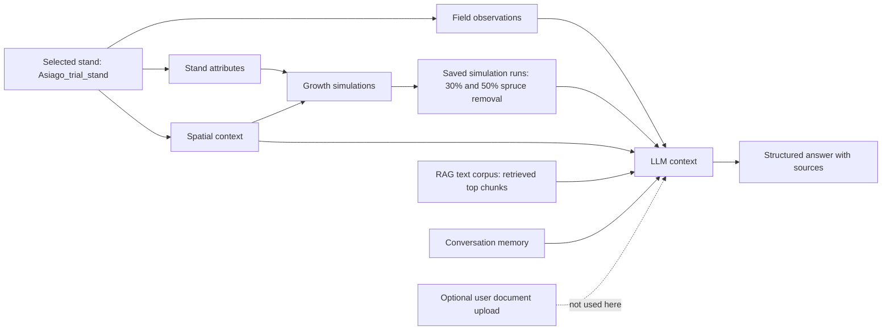

# Results

## Prototype implementation

ForestGPT was implemented as a Docker-based web application. The prototype combines a FastAPI backend, a Leaflet-based map interface, a PostGIS spatial database, a growth simulation module, and a retrieval-augmented language model interface. The application can be started from the Docker Compose configuration and used in a browser. This setup allowed the stand database, spatial analysis, simulation routines, retrieval module, and chat interface to be tested together in one reproducible local environment.

## Stand and spatial context

The results shown here refer to the currently active stand, the `Asiago_trial_stand` (stand ID 41). The stand is a mixed stand dominated by Norway spruce (`Picea abies`) with a small larch component (`Larix decidua`). The stand age used in the prototype was 50 years. The mapped stand area was 2.023 ha and the perimeter was 683.3 m. The centroid of the stand was located at 11.482325 degrees longitude and 45.901407 degrees latitude.

The spatial context was derived from the stand geometry, the digital terrain model, and the available road layer. The mean altitude was 1386.2 m, with a minimum of 1364.6 m and a maximum of 1411.6 m. Mean slope was 11.4 degrees, with local values reaching 28.0 degrees. The dominant aspect was east-facing, and the mean terrain ruggedness index was 2.67. The nearest forest road was located very close to the stand boundary, which is relevant for timber extraction and for the placement of harvesting infrastructure.

The map view of the application shows the stand polygon together with terrain and road information. When the user selects the stand, the application opens a stand information panel with the main stand attributes and provides access to simulation, observation, and chat functions.

**Figure 1.** Map and stand context of the `Asiago_trial_stand`. The figure should show the selected stand polygon, the terrain background or derived terrain information, and the nearby forest road layer.

## Generated answers to practical forestry questions

Two practical questions were used to test whether ForestGPT can combine stand attributes, simulation output, field observations, spatial context, retrieved literature, and previous conversation memory into a structured answer. The questions were selected to represent decisions that may occur in operational forestry: the comparison of thinning variants and the choice of harvesting technology.

### Question 1: comparison of two thinning variants

The first question asked:

> We applied two thinning variants for this stand. Both represent rather late thinning schedules. The first thinning variant includes a normal to moderate removal of spruce trees, and the second variant represents a heavy removal of spruce trees in this stand. When considering economic and ecological criteria, which variant is most appropriate in your opinion?

ForestGPT recommended the moderate thinning variant. In this variant, 30% of the spruce stems were removed in year 5 of the 30-year simulation, while no larch stems were removed. The alternative heavy thinning variant removed 50% of the spruce stems in the same year. The recommendation was based on the higher remaining stand volume and basal area in the moderate thinning variant, the management goal of producing high-quality timber, and the field observation that the remaining larch trees should be retained and supported.

At the end of the simulation period, the moderate thinning run reached a total standing volume of 571.35 m3/ha and a total basal area of 52.93 m2/ha. The heavy thinning run reached 513.32 m3/ha and 45.64 m2/ha. The moderate variant therefore maintained a denser growing stock while still allowing a delayed intervention. This was interpreted as more consistent with the stated management objective of producing high-quality timber with few thinnings and a late last thinning.

The generated answer also stated the main uncertainties. The simulation should be interpreted as a prototype-level result because the r3PG model run used a simplified site setup and reported that an example climate and site location were used. In addition, timber prices, harvesting costs, disturbance risks, and local silvicultural knowledge were not explicitly modeled.

The answer listed the following source types: stand data and spatial context, simulation outputs, field observations, previous conversation memory, and the RAG text corpus. Retrieved text chunks included forestry operations and forest growth sources.

### Question 2: harvesting system recommendation

The second question asked:

> For the thinning variant that you are suggesting, which harvesting machine configuration would you recommend? Is ground-based or cable-based technology more advisable? When answering, please consider technical, economic, and environmental considerations.

ForestGPT recommended a cable-based harvesting system for the moderate thinning variant. The recommendation was mainly justified by the terrain conditions of the stand. Although the mean slope was moderate, local slopes reached 28.0 degrees and the terrain ruggedness index indicated uneven terrain. A cable-based system was therefore considered more suitable than a purely ground-based system because it can reduce soil disturbance, limit damage to residual trees, and improve safety in steeper sections.

The answer also considered economic and operational aspects. The proximity of a forest road supports the use of cable yarding because the road can provide access and landing space. The moderate thinning intensity also fits a selective harvesting operation in which residual stand damage should be minimized. Environmentally, cable-based extraction was preferred because it can reduce soil compaction and erosion risks compared with ground-based skidding, especially in sensitive or steep parts of the stand.

The generated answer stated that the recommendation depends on local feasibility, machine availability, operator experience, and the actual bearing capacity of the soil. It also noted that the dense stand structure and the presence of valuable larch trees require careful planning during extraction. The answer listed stand data, terrain summary, simulation outputs, field observations, the RAG text corpus, and previous conversation memory as sources.

## Growth simulation output

Two simulation runs were compared for the active stand. Both simulations covered 30 years, starting from stand age 50 and ending at age 79. Both used the same initial species composition: 900 spruce stems/ha with a mean height of 22 m and mean DBH of 23 cm, and 50 larch stems/ha with a mean height of 23 m and mean DBH of 24 cm. The difference between the simulations was the thinning intensity in year 5. Run 150 represented the moderate thinning variant, with 30% spruce removal. Run 149 represented the heavy thinning variant, with 50% spruce removal.

| Simulation run | Thinning treatment | Total volume 2026 (m3/ha) | Total volume 2031 (m3/ha) | Total volume 2055 (m3/ha) | Total basal area 2026 (m2/ha) | Total basal area 2031 (m2/ha) | Total basal area 2055 (m2/ha) |
|---|---:|---:|---:|---:|---:|---:|---:|
| 150 | 30% spruce removal in year 5 | 349.31 | 292.44 | 571.35 | 39.70 | 31.76 | 52.93 |
| 149 | 50% spruce removal in year 5 | 349.31 | 223.37 | 513.32 | 39.70 | 23.89 | 45.64 |

The strongest difference between the two simulations occurred directly after thinning. In 2031, the heavy thinning variant had a much lower total basal area and standing volume than the moderate thinning variant. Both variants recovered over time, but the moderate thinning variant kept higher total volume and basal area until the end of the simulation. Mean diameter increased in both variants, with somewhat stronger individual-tree growth after heavier removal, especially for the larch component. However, this did not compensate for the lower total growing stock in the heavy thinning variant within the simulated period.

**Figure 2.** Simulated stand development under two thinning variants for the `Asiago_trial_stand` ([figures/asiago_growth_simulation.svg](/Users/bennoeberhard/Projects/Exercise_Projects/mini_project_4/ForestGPT_trial/figures/asiago_growth_simulation.svg)). The figure contains four panels: basal area, mean diameter, mean height, and standing volume. Each panel compares the moderate thinning variant (run 150, 30% spruce removal in year 5) with the heavy thinning variant (run 149, 50% spruce removal in year 5). The dashed vertical line marks the thinning year. The plotted values show selected years from the saved simulation outputs.

## Demonstrated workflow and application capabilities

The example demonstrated that ForestGPT can connect several information sources within one interactive workflow. The user selected the `Asiago_trial_stand`, inspected its stand and terrain context, performed two growth simulations, added field observations, asked practical management questions, and received structured language model answers with explicit source reporting.

**Figure 3.** Workflow demonstrated by the prototype. The active stand provided stand attributes, spatial context, field observations, and simulation outputs. These were combined with retrieved text chunks from the RAG corpus and previous conversation memory to generate a structured answer. User document upload is part of the application design but was not used in this example.

In this example, the application successfully combined the following elements:

- Stand context: stand ID, species composition, age, area, perimeter, altitude, and centroid.
- Spatial context: slope, aspect, terrain ruggedness, elevation range, and nearby road information.
- Simulation context: two 30-year simulation runs with different spruce thinning intensities in year 5.
- Field observations: local management goals, timber-quality orientation, and observations on larch competition.
- Retrieval context: relevant chunks from the text corpus, especially on forestry operations and harvesting systems.
- Conversation memory: previous questions and answers from the same chat session.
- Answer generation: structured recommendations with reasoning, uncertainties, and source reporting.

Overall, the results show that ForestGPT can act as an integrative decision-support prototype. It does not replace expert judgement or detailed operational planning, but it can organize stand-specific data, simulation results, field knowledge, spatial information, and literature excerpts into a coherent response. The Asiago example also shows the importance of transparent source reporting, because the user can see whether a recommendation is based mainly on stand data, model output, field observations, retrieved text, or previous conversation context.
